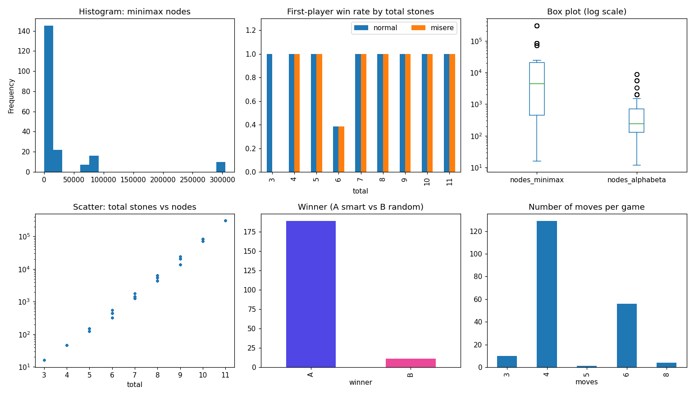

<div dir="rtl">

# گزارش کار آزمایشگاه هوش مصنوعی — جلسه چهارم
## بازی Nim با Minimax و Alpha-Beta، توسعهٔ «قانون معکوس (Misère)» و تحلیل اکتشافی داده‌ها (EDA)

| | |
|---|---|
| **درس** | آزمایشگاه هوش مصنوعی |
| **موضوع** | جستجوی تخاصمی (Adversarial Search) و گام سوم پروژه: EDA |
| **توسعهٔ انتخابی** | قانون معکوس (Misère): برندهٔ بازی کسی است که آخرین سنگ را **برنمی‌دارد** |
| **فایل اصلی** | `lab3_nim_misere_eda.ipynb` |
| **محیط اجرا** | Python 3، Anaconda (`conda activate ailab`)، Jupyter Notebook |
| **کتابخانه‌ها** | `numpy`، `pandas`، `matplotlib` |

---

## ۱. چکیده

در این پروژه بازی Nim با سه پشته سنگ پیاده‌سازی شد و با الگوریتم‌های Minimax و Alpha-Beta حل شد. از بین چهار توسعهٔ پیشنهادی، **قانون معکوس (Misère)** به‌صورت عملی در کد اعمال شد. سپس با ۲۰۰ بازی شبیه‌سازی‌شده یک دیتاست ساخته شد و گام سوم پروژه (EDA) شامل بررسی کیفیت داده، آمار توصیفی، سؤال‌های تحلیلی، نمودار و تفسیر روی آن انجام شد.

**نتایج کلیدی:**

- پیاده‌سازی قانون معکوس با **صفر اختلاف** هم با Minimax در برابر Alpha-Beta و هم با فرمول نظریهٔ Misère تأیید شد.
- بازیکن اول در قانون معکوس از **۸۸٪** شروع‌ها برنده است (در قانون عادی ۹۰٫۵٪).
- دو قانون فقط در شروع (۱، ۱، ۱) نتیجهٔ متفاوت دارند (۵ بازی از ۲۰۰ بازی).
- Alpha-Beta تنها **۲٫۹٪** گره‌های Minimax را بررسی می‌کند.
- بازیکن هوشمند در برابر حریف تصادفی **۹۴٫۵٪** بازی‌ها را می‌برد.

---

## ۲. ساختار پروژه

```
.
├── lab3_nim_misere_eda.ipynb   # نوت‌بوک اجراشده (کد + خروجی + گزارش)
├── nim_games_misere.csv        # دیتاست ۲۰۰ بازی
├── eda_charts.png              # نمودارهای EDA
└── README.md                   # همین گزارش
```

---

## ۳. شرح بازی

- چند پشته سنگ داریم؛ دو بازیکن **A (MAX)** و **B (MIN)** نوبتی بازی می‌کنند.
- در هر نوبت یک یا چند سنگ از **یک پشته** برداشته می‌شود.
- **قانون عادی:** برداشتن آخرین سنگ = برد.
- **قانون معکوس (Misère):** برداشتن آخرین سنگ = باخت.
- سودمندی: ‎+۱‎ یعنی A می‌برد و ‎−۱‎ یعنی B می‌برد.
- حالت اولیهٔ استاندارد: `START = (3, 4, 5)`.

فرمول‌بندی به‌صورت مسئلهٔ جستجو: حالت اولیه، اعمال (برداشتن k سنگ از یک پشته)، نتیجه (پشته‌های جدید)، آزمون پایان (همهٔ پشته‌ها خالی) و سودمندی (‎±۱‎).

---

## ۴. توسعهٔ انجام‌شده: قانون معکوس

### ۴.۱ تغییرات کد

| تغییر | توضیح |
|---|---|
| `terminal_value(player, misere)` | تابع جدید؛ ارزش صفحهٔ خالی را بر اساس قانون برمی‌گرداند. بازیکنی که نوبتش است آخرین سنگ را برنداشته؛ حریفش برداشته است. در قانون عادی برداشت‌کننده برنده است و در معکوس بازنده. |
| `misere=False` در `minimax`، `alphabeta`، `best_move` | پارامتر جدید که تا برگ‌های درخت عبور داده می‌شود. مقدار پیش‌فرض همان رفتار کلاسی است، پس کد قبلی نمی‌شکند. |
| Cell 4 | شمارش گره‌ها برای هر دو قانون |
| Cell 4b | اعتبارسنجی خودکار (بخش ۴.۳) |
| Cell 5 | جدول داده با ستون‌های مقایسهٔ دو قانون؛ بازی‌ها با قانون معکوس انجام می‌شوند و برنده بازیکنی است که نوبتش در پایان است |
| Cell 9 | انیمیشن بازی با قانون معکوس |

### ۴.۲ نحوهٔ عملکرد

درخت بازی و منطق max/min و هرس α ≥ β و ترتیب `big_first` بدون تغییر ماندند. تنها ارزش برگ‌ها وارونه می‌شود. بنابراین بازیکن هوشمند A طوری حرکت می‌کند که حریف مجبور به تحویل آخرین سنگ به او نباشد و خودش مجبور به برداشتن آخرین سنگ نشود.

### ۴.۳ اعتبارسنجی

دو آزمون در Cell 4b اجرا شد:

1. **Minimax در برابر Alpha-Beta:** روی همهٔ حالت‌های سه‌پشته‌ای با اندازهٔ `0..3` و برای هر دو قانون؛ **۰ اختلاف**.
2. **جستجو در برابر نظریهٔ Misère:** روی همهٔ حالت‌های `0..4`؛ **۰ اختلاف**. فرمول نظریه:
   - اگر حداقل یک پشته ≥ ۲ باشد: بازیکن نوبت‌دار می‌برد ⇔ `nim_sum ≠ 0`
   - اگر همهٔ پشته‌ها ≤ ۱ باشند: بازیکن نوبت‌دار می‌برد ⇔ تعداد پشته‌های تک‌سنگی زوج باشد

### ۴.۴ اثر بر هزینهٔ جستجو (از حالت شروع (۳، ۴، ۵))

| الگوریتم | قانون عادی | قانون معکوس |
|---|---:|---:|
| Minimax | 1,038,768 | 1,038,768 |
| Alpha-Beta (ترتیب طبیعی) | 33,916 | 30,492 |
| Alpha-Beta (ترتیب `big_first`) | 4,332 | 3,763 |

مقدار حالت شروع در هر دو قانون ‎+۱‎ است. ترتیب `big_first` تعداد گره‌های Alpha-Beta را تقریباً ۸ برابر کمتر می‌کند.

---

## ۵. دیتاست

### ۵.۱ روش ساخت

- ۲۰۰ بازی؛ هر شروع به‌صورت تصادفی (`rng = np.random.default_rng(0)`) با سه پشته از ۱ تا ۴ سنگ.
- بازیکن A هوشمند است (`best_move` با قانون معکوس) و بازیکن B حرکت تصادفی انجام می‌دهد.
- هر ردیف یک بازی است و خروجی در `nim_games_misere.csv` ذخیره می‌شود.

### ۵.۲ توضیح ستون‌ها

| ستون | نوع | معنی |
|---|---|---|
| `p1`، `p2`، `p3` | int | اندازهٔ پشته‌ها در شروع |
| `total` | int | مجموع سنگ‌ها |
| `max_pile` | int | بزرگ‌ترین پشته |
| `nim_sum` | int | XOR اندازهٔ پشته‌ها |
| `first_wins_normal` | bool | آیا بازیکن اول در قانون عادی می‌برد؟ |
| `first_wins_misere` | bool | آیا بازیکن اول در قانون معکوس می‌برد؟ |
| `nodes_minimax` | int | تعداد گره‌های Minimax (قانون معکوس) |
| `nodes_alphabeta` | int | تعداد گره‌های Alpha-Beta با `big_first` (قانون معکوس) |
| `moves` | int | تعداد حرکت‌های بازی شبیه‌سازی‌شده |
| `winner` | str | برندهٔ بازی (`A` یا `B`) |
| `rule_differs` | bool | آیا نتیجهٔ دو قانون برای این شروع متفاوت است؟ |

---

## ۶. تحلیل اکتشافی داده‌ها (EDA)

### ۶.۱ کیفیت داده

| شاخص | نتیجه |
|---|---|
| ابعاد | ۲۰۰ ردیف × ۱۳ ستون |
| مقادیر گمشده | ۰ |
| ردیف‌های تکراری | ۱۱۴ (۵۷٪) |
| شروع‌های متمایز | ۶۰ از ۶۴ حالت ممکن |
| نوع ستون‌ها | ۹ عدد صحیح، ۳ بولی، ۱ متنی |
| بازهٔ منطقی | همهٔ پشته‌ها در ۱ تا ۴ و `total = p1 + p2 + p3` همیشه برقرار |

**تکرار طبیعی است:** تعداد شروع‌های ممکن فقط ۶۴ است، پس در ۲۰۰ بازی تکرار شروع اجتناب‌ناپذیر است. این ردیف‌ها حذف نشدند، ولی در تحلیل به آن توجه شده است.

### ۶.۲ آمار توصیفی

| ستون | میانگین | میانه | انحراف معیار | کمینه | بیشینه |
|---|---:|---:|---:|---:|---:|
| `total` | 7.5 | 8 | 2.0 | 3 | 11 |
| `nodes_minimax` | 28,875.3 | 4,348 | 68,173.8 | 16 | 305,192 |
| `nodes_alphabeta` | 831.6 | 240 | 1,594.7 | 12 | 8,673 |
| `moves` | 4.6 | 4 | 1.1 | 3 | 8 |

برای `nodes_minimax`: واریانس ≈ ۴٫۶۵ × ۱۰⁹، چولگی ۳٫۳۹ و ۳۳ نقطهٔ پرت به روش IQR (۱۶٫۵٪). میانگین حدود ۶٫۶ برابر میانه است؛ پس توزیع به راست کج است و **میانه** برای توصیف مناسب‌تر است.

### ۶.۳ سؤال‌های تحلیلی

| # | سؤال | پاسخ |
|---|---|---|
| ۱ | آیا بازی برای بازیکن اول منصفانه است؟ | بازیکن اول در ۸۸٪ شروع‌ها (قانون معکوس) و ۹۰٫۵٪ (قانون عادی) می‌برد. |
| ۲ | آیا نظریه با جستجو هم‌خوان است؟ | جستجو با فرمول Misère در ۱۰۰٪ موارد و `nim_sum ≠ 0` تنها در ۹۷٫۵٪ موارد هم‌خوان است. |
| ۳ | دو قانون کجا اختلاف دارند؟ | در ۵ بازی؛ همگی شروع (۱، ۱، ۱). |
| ۴ | Alpha-Beta چقدر صرفه‌جویی می‌کند؟ | فقط ۲٫۹٪ گره‌های Minimax بررسی می‌شود. |
| ۵ | A هوشمند در برابر B تصادفی چقدر می‌برد؟ | ۱۸۹ از ۲۰۰ بازی (۹۴٫۵٪). |
| ۶ | هزینهٔ جستجو با چه چیزی مرتبط است؟ | همبستگی `total` با `nodes_minimax` برابر ۰٫۶۱ و با `nodes_alphabeta` برابر ۰٫۵۷ است. |

### ۶.۴ نمودارها



| نمودار | سؤالی که پاسخ می‌دهد |
|---|---|
| هیستوگرام `nodes_minimax` | توزیع هزینه چه شکلی است؟ (به راست کج و دارای چند مقدار سنگین) |
| میله‌ای نرخ برد بر اساس `total` | آیا دو قانون فرق دارند؟ (فقط در `total = 3`: عادی ۱٫۰ و معکوس ۰) |
| جعبه‌ای (مقیاس لگاریتمی) | Alpha-Beta چقدر هزینه را کم و پراکندگی را کنترل می‌کند؟ |
| پراکندگی `total` در برابر گره‌ها (لگاریتمی) | رابطهٔ اندازهٔ مسئله و هزینه (تقریباً خطی در مقیاس لگاریتمی، یعنی رشد نمایی) |
| میله‌ای برنده | A هوشمند در برابر B تصادفی |
| میله‌ای تعداد حرکت‌ها | بیشتر بازی‌ها ۴ حرکته (۱۲۹ بازی) و سپس ۶ حرکته (۵۶ بازی) هستند. |

---

## ۷. تفسیر نتایج (مشاهده، دلیل، نتیجه)

| مشاهده | دلیل | نتیجه |
|---|---|---|
| بازیکن اول در قانون معکوس از ۸۸٪ شروع‌ها برنده است | در بیشتر شروع‌ها `nim_sum ≠ 0` است | شروع‌کننده در هر دو قانون برتری دارد، در Misère کمی کمتر |
| دو قانون فقط در ۵ بازی (۲٫۵٪) نتیجهٔ متفاوت دارند و همه (۱، ۱، ۱) هستند | تعداد حرکت‌ها ثابت و فرد (۳) است و A آخرین سنگ را برمی‌دارد و در Misère می‌بازد | تفاوت دو قانون فقط در پایان‌بازی با پشته‌های تک‌سنگی دیده می‌شود |
| هم‌خوانی ۱۰۰٪ با فرمول Misère و ۹۷٫۵٪ با `nim_sum` | فرمول Misère جز حالت «همه ≤ ۱» همان XOR است | درستی پیاده‌سازی تأیید می‌شود |
| Alpha-Beta فقط ۲٫۹٪ گره‌ها را دید | شاخه‌های بی‌اثر هرس می‌شوند و `big_first` هرس را زود فعال می‌کند | هزینه حدود ۳۴ برابر کمتر شد |
| میانگین گره‌ها ۲۸٬۸۷۵ و میانه ۴٬۳۴۸ و ۳۳ نقطهٔ پرت | شروع‌های سنگین با مجموع ۱۰ و ۱۱ توزیع را کج می‌کنند | برای توصیف از میانه و مقیاس لگاریتمی استفاده شود |
| همبستگی `total` و `nodes_minimax` برابر ۰٫۶۱ و در مقیاس لگاریتمی تقریباً خطی | هر سنگ اضافه فضای حالت را چند برابر می‌کند | رشد هزینه تقریباً نمایی است و همبستگی خطی آن را کمتر از واقع نشان می‌دهد |
| A هوشمند ۹۴٫۵٪ بازی‌ها را برد | هر ۱۱ باخت از شروع‌های بازنده بود؛ از ۲۴ شروع بازنده (۱۲٪)، در ۱۱ مورد B تصادفی اشتباه نکرد | بازیکن کامل جز در شروع بازنده نمی‌بازد و آنجا هم فقط با خطای حریف می‌برد |

---

## ۸. محدودیت‌ها

- فقط ۲۰۰ بازی و ۶۴ شروع ممکن (پشته‌ها ۱ تا ۴).
- حریف B تصادفی است؛ نرخ برد ۹۴٫۵٪ دربارهٔ دو بازیکن کامل چیزی نمی‌گوید.
- ۵۷٪ ردیف‌ها تکراری‌اند؛ آمار تجمیعی (مثل میانگین) به شروع‌های پرتکرار وزن بیشتری می‌دهد.
- ستون‌های `nodes_*` به ترتیب حرکت‌ها و پیاده‌سازی بستگی دارند و تعداد واقعی حالت‌های متمایز بازی را نشان نمی‌دهند.

## ۹. کارهای آینده

- انجام چالش «B هم هوشمند» و مقایسهٔ نتیجه با دو بازیکن کامل.
- چالش «چهار پشته» و تعمیم `nim_sum` و فرمول Misère.
- ساخت داده برای بازهٔ پشته‌های ۱ تا ۵ و بررسی اثر روی هزینهٔ جستجو.
- حذف ردیف‌های تکراری یا نمونه‌گیری یکنواخت از ۶۴ شروع برای تحلیل بدون سوگیری.

---

## ۱۰. راهنمای اجرا

```bash
conda activate ailab
pip install numpy pandas matplotlib jupyter
jupyter notebook
```

فایل `lab3_nim_misere_eda.ipynb` را باز کنید و سلول‌ها را از بالا به پایین با **Shift+Enter** اجرا کنید. اجرای کامل `nim_games_misere.csv` و `eda_charts.png` را در پوشهٔ نوت‌بوک می‌سازد. بخش ساخت داده (Cell 5) و شمارش گره‌ها (Cell 4) ممکن است کمی زمان‌بر باشند، چون Minimax کامل و بدون هرس اجرا می‌شود.

**تکرارپذیری:** بذر تصادفی داده `0` و بذر انیمیشن `1` است؛ با همین بذرها نتایج بالا دوباره به‌دست می‌آیند.

</div>
